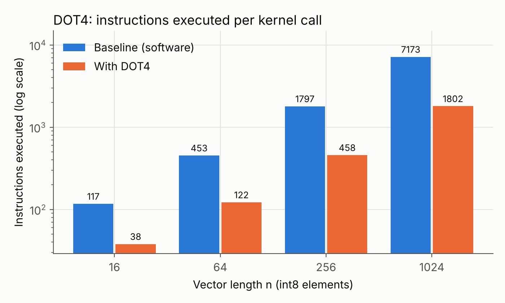
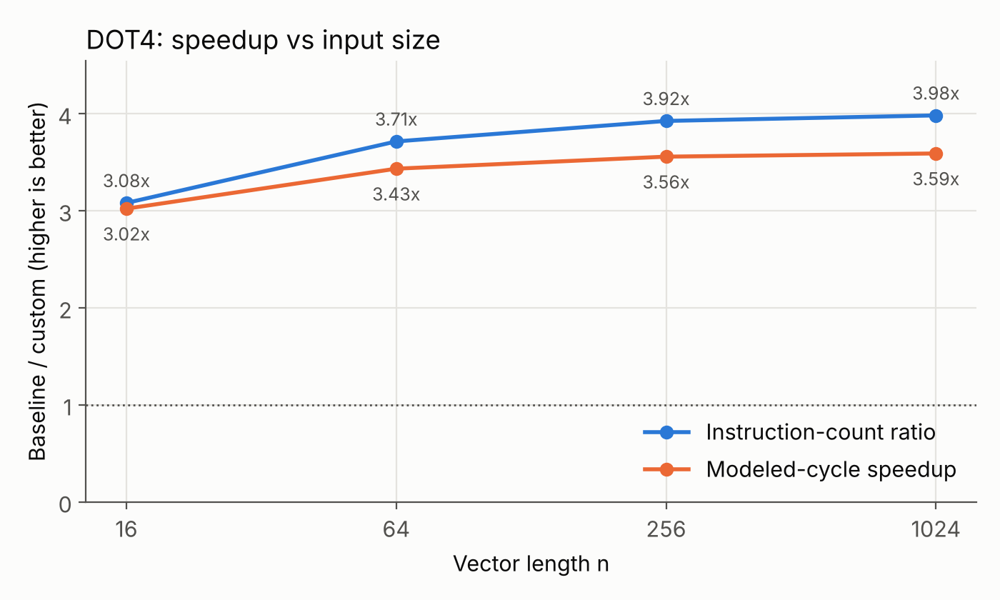
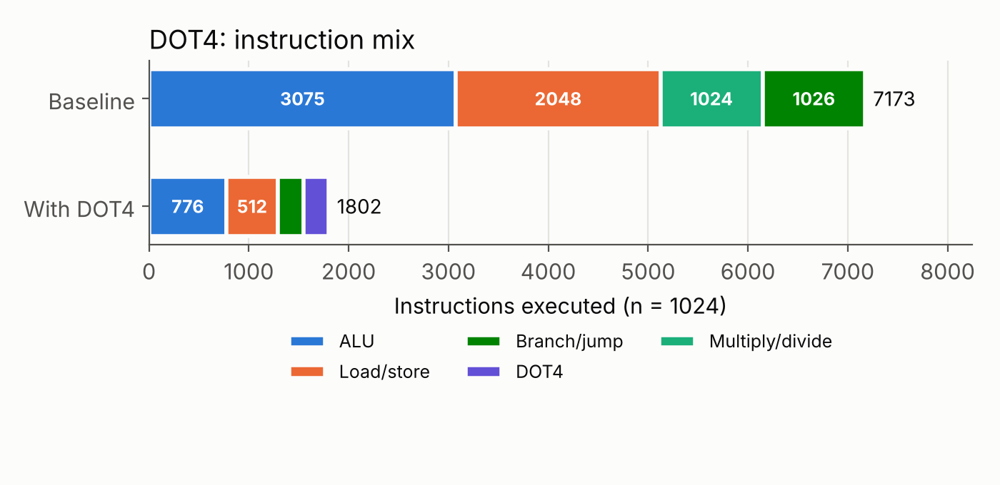
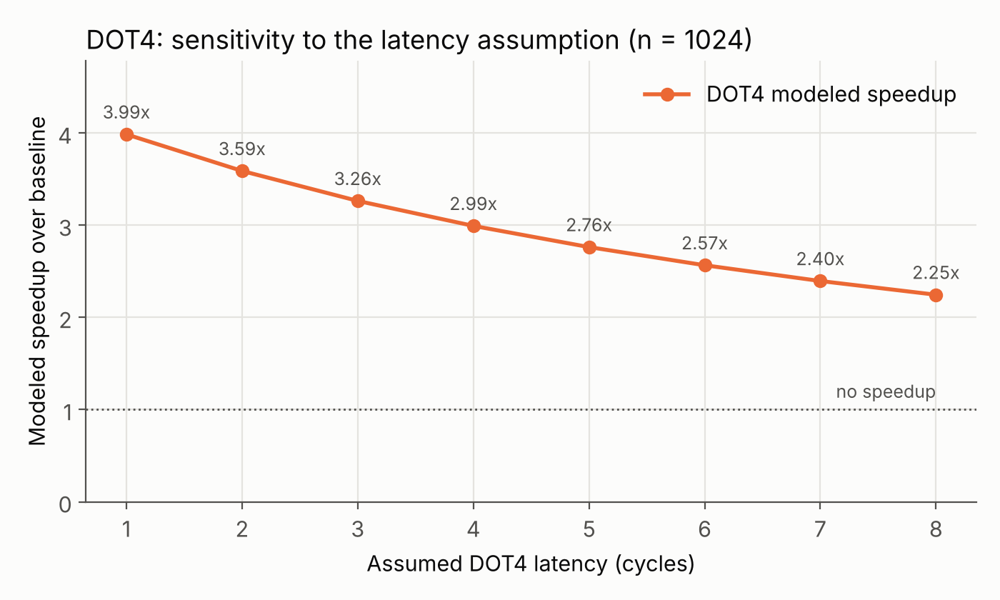
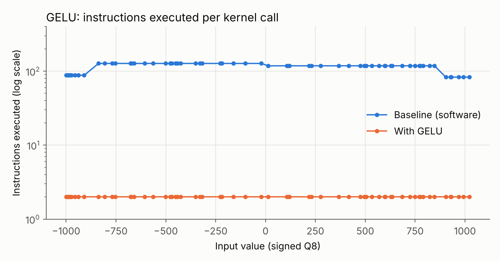
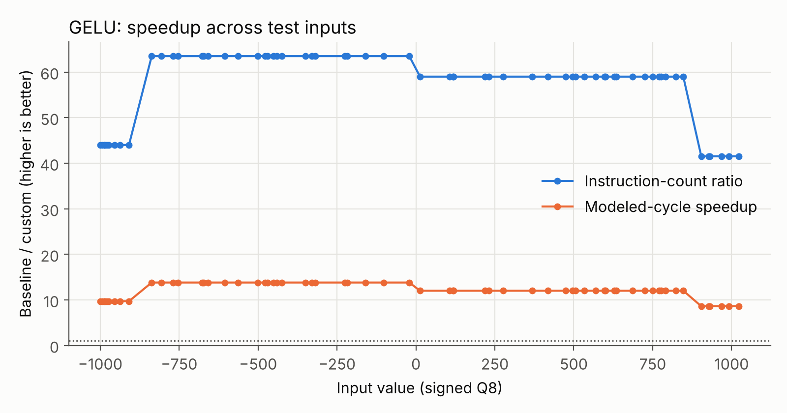
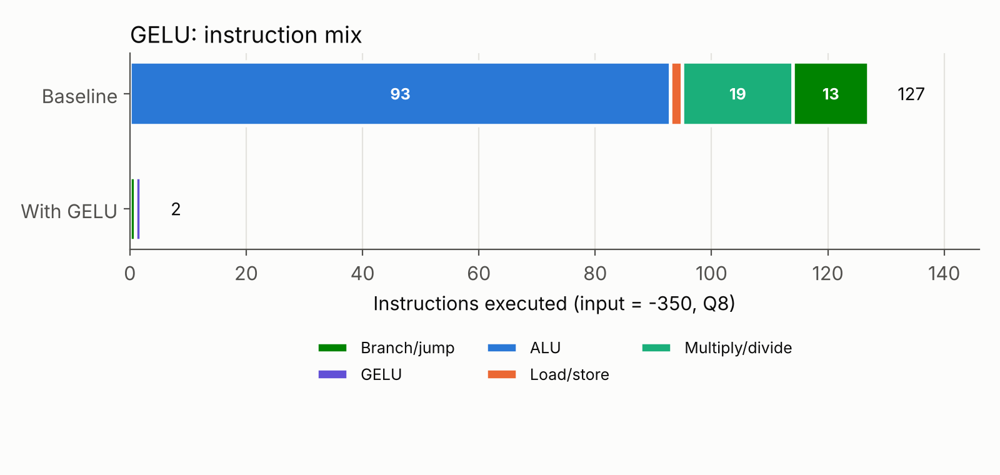
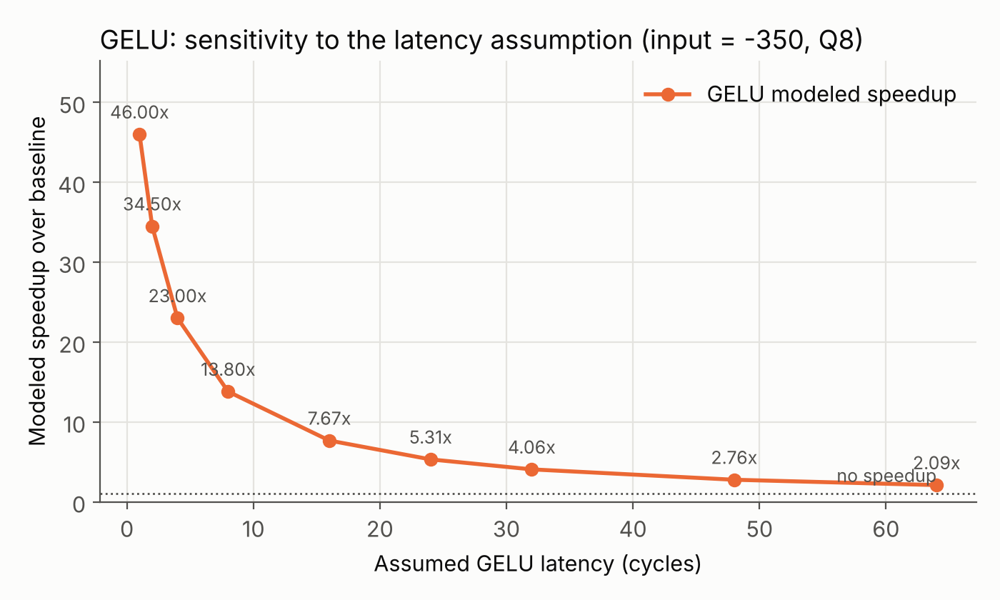

# Custom ISA Extensions for Transformer Primitives

**CECS 530 — Advanced Computer Architecture | CSULB Fall 2026 | Sec 01**

This repository contains the code, experiments and documentation for designing custom RISC-V instructions that accelerate Transformer operations. We add the instructions to the Spike simulator, run the same kernels with and without them, and compare instruction count and modeled execution cycles.

> **Status:** the two primitives are locked: **DOT4** and **GELU**. Both are implemented in Spike and run with `./scripts/run_dot.sh` and `./scripts/run_gelu.sh`. See [Project Status](#project-status).

---

## Research Question

> Which custom RISC-V instructions reduce the instruction count and modeled cycles of Transformer primitives the most, and how sensitive is that gain to the latency we assume for the new instruction?

**Objectives**
1. Define at least two custom instructions (name, binary encoding, exact behavior).
2. Implement them in Spike and call them from C kernels.
3. Run each kernel as a baseline (standard RV32IM) and as a custom version, and check both against a Python reference.
4. Measure instruction count, modeled cycles and speedup across input sizes.
5. Explain from a computer-architecture view where the gain comes from and what it costs.

**Expected outcome (hypotheses, not results).** A hand count for 4 int8 elements gives 28 baseline instructions (19 with 4x loop unrolling) against 6 with a fused dot-product instruction. Measured numbers will replace these. The gain for GELU depends on the data type and on how good the baseline approximation is, so it may be smaller.

## Background

| Term | Meaning |
|---|---|
| **ISA** | Instruction Set Architecture: the list of instructions a processor understands |
| **RV32I** | RISC-V base integer ISA, 32-bit, 40 instructions |
| **M extension** | Adds multiply and divide. Our baseline is **RV32IM** (base + M) |
| **ISA extension** | New instructions added on top of an ISA. Ours use the reserved `custom-0` opcode (`0x0B`) |
| **Kernel** | A small program that does one operation, such as a dot product |
| **Spike** | The RISC-V reference simulator: a program that behaves like a RISC-V CPU |
| **Speedup** | Baseline cycles ÷ custom cycles |
| **Amdahl's law** | Total speedup is limited by the fraction of runtime the improved part represents |

### Transformer primitives

| Primitive | Where it appears | What it computes |
|---|---|---|
| **Dot product** | Attention scores and every matrix multiply | Multiply pairs of numbers, then sum them |
| **GELU** | Feed-forward block | A smooth activation applied to each value |

Standard RISC-V has no instruction for these, so each becomes a long chain of simple ones. A dot product needs 7 instructions per element (2 loads, multiply, add, 2 pointer updates, branch). GELU needs `tanh` or `erf`, which have no instruction.

### Related hardware

Fused 8-bit dot products already exist elsewhere: Arm `SDOT`/`UDOT`, x86 `VPDPBUSD` (VNNI) and NVIDIA `dp4a` all multiply four 8-bit pairs and accumulate into 32 bits [7–9]. RISC-V has a vector draft, `Zvdot4a8i` (formerly `Zvqdotq`), whose ratification we could not confirm [10]. Our instructions are scalar and live in the `custom-0` slot. The contribution is the implementation and the measurements.

## Custom Instructions

Two instructions, both in the `custom-0` slot (`0x0B`, R-type).

| Instruction | funct3 | Primitive | What it does |
|---|---|---|---|
| `dot4 rd, rs1, rs2` | 0 | Dot product | `rd += sum of 4 signed int8 products` from the bytes packed in `rs1` and `rs2` |
| `gelu rd, rs1` | 1 | GELU | `rd = GELU(rs1)` for a Q8 fixed-point input, using a 65-entry Q15 `tanh` table with linear interpolation |

**GELU design.** Values are signed Q8 integers (real value = integer / 256). The kernel computes `0.5 * x * (1 + tanh(sqrt(2/pi) * (x + 0.044715 * x^3)))` in integer arithmetic. `tanh` comes from a 65-entry Q15 table covering 0 to 4 in steps of 1/16, with linear interpolation, odd symmetry for negative inputs, and clamping beyond 4. Inputs of 4.0 or more return `x`, and inputs of -4.0 or less return 0. The software baseline (`kernels/gelu/gelu.c`) and the plugin (`patches/riscv-isa-sim/customext/gelu.cc`) use the same table and rounding, so their outputs are bit-identical.

## Methodology

```
 kernel.c ──► GCC (RV32IM integer code) ──► program.elf ──► Spike (+ our instruction) ──► instruction counts ──► cost model (Python) ──► cycles, speedup, graphs
 (baseline | custom)

 Python reference ──► expected outputs ──► compared with the program's output (correctness)
```

**Simulator.** [Spike](https://github.com/riscv-software-src/riscv-isa-sim), pinned to commit `4c6a9bc` so all three of us build the same code. Spike is a functional simulator: it runs programs correctly but has no timing model. Its documented way to add an instruction is a behavior file plus an opcode entry in the Spike source tree [5]. Spike can also load instructions from a shared library with `--extlib`, which would let us leave Spike unmodified. We use the plugin route: our instructions live in `patches/riscv-isa-sim/customext/` and `scripts/setup.sh` builds them into a plugin library that Spike loads with `--extlib` and `--extension`.

**Cycle model.** Cycles are modeled, not measured: cycles = Σ (instruction count × assumed latency per instruction class). One latency table (`model/latencies.json`, based on the OpenHW CV32E40P core) is used for both the baseline and the custom kernels, which the instructor approved. The latency of each custom instruction is an assumption, so we sweep it: `dot4` from 1 to 8 cycles and `gelu` from 1 to 64 cycles. Even at 64 cycles the GELU instruction is still about 2x faster than the software baseline.

**Fair baseline.** The baseline is compiled with a reasonable optimization level and compared against loop-unrolled variants, so the speedup is not inflated.

**Metrics.** Instruction count, modeled cycles, speedup per input size, and correctness against the Python reference.

## Experimental Setup

| Item | Value |
|---|---|
| Baseline ISA | RV32IM |
| Compiler | GCC 13.2.0 for RISC-V bare metal (`gcc-riscv64-unknown-elf`, Ubuntu 24.04). Flags: `-O2 -ffp-contract=off -ffreestanding -nostdlib` (see `scripts/build.sh`) |
| Simulator | Spike, commit `4c6a9bc` |
| Custom opcode | `custom-0` (`0x0B`), R-type, assembled with `.insn` [6] |
| Data type | DOT4: int8 inputs, int32 accumulator. GELU: signed Q8 int32, Q15 `tanh` table |
| Kernels | Dot product and GELU, each as baseline and custom |
| Input sizes | DOT4: vector lengths up to 1024. GELU: 16 directed inputs and 64 random inputs in [-1023, 1023] (Q8) |

## Repository Structure

```
.
├── README.md
├── .gitignore
├── runtime/     bare-metal startup, linker script, console helpers
├── kernels/     dot/ and gelu/: baseline and custom versions
├── bench/       benchmark programs (bench_dot.c, bench_gelu.c)
├── tests/       test-vector generator, float64 accuracy check, directed assembly tests
├── patches/     Spike plugin sources (dot4.cc, gelu.cc, gelu_lut.h)
├── model/       cycle-cost table (latencies.json)
├── scripts/     setup, build, run, analyze, model and plot scripts
├── results/     dot4/ and gelu/: result CSVs and plots/ for each primitive (gelu/ also has the accuracy report)
└── third_party/ , build/   Generated locally, not tracked by git
```

## Getting Started

Checked on Ubuntu 24.04 (WSL) and in a cloud Ubuntu 24.04 container: both give identical results.

### 1. Prerequisites

| Platform | Install |
|---|---|
| **Windows** | Install WSL 2 with Ubuntu 24.04 (`wsl --install -d Ubuntu-24.04`), then work inside the Linux filesystem (`~/`), not under `/mnt/c`. Follow the Ubuntu line below. |
| **Ubuntu 24.04** | `sudo apt update && sudo apt install -y build-essential git python3 python3-matplotlib device-tree-compiler libboost-regex-dev libboost-system-dev gcc-riscv64-unknown-elf` |
| **macOS** | Not yet tested |

Run `sudo apt update` first: a stale package list gives `404 Not Found` errors. Check the compiler: `riscv64-unknown-elf-gcc --version` (we used GCC 13.2.0; instruction counts can change with the compiler version).

### 2. Clone the repository

```bash
git clone https://github.com/omargalal20/cecs530-riscv-transformer-isa-extension.git
cd cecs530-riscv-transformer-isa-extension
```

### 3. Build Spike and our instruction plugins

```bash
./scripts/setup.sh
```

This fetches Spike at the pinned commit `4c6a9bc`, copies the plugin sources from `patches/riscv-isa-sim/customext/` into it, and builds everything into `third_party/install/`. The first run takes roughly 10 to 20 minutes; re-runs take a few minutes. It ends with `Done. Spike: ...`.

### 4. Run the DOT4 experiment

```bash
./scripts/run_dot.sh
```

Expect six `PASS` lines, then `results: results/dot4/bench_dot_results.csv, plots: results/dot4/plots/`. The row for n=1024 should read `rand_1024,1024,7173,1802,3.981,9220,2569,3.589`.

What the script does: builds the kernels, runs them on Spike with the DOT4 plugin, counts executed instructions from Spike's trace (`scripts/analyze.py`), applies the cost model (`scripts/model.py`, table in `model/latencies.json`) and draws the plots (`scripts/plots.py`).

### 5. Run the GELU experiment

```bash
./scripts/run_gelu.sh
```

Expect 80 lines ending in `PASS` and `Total cases: 80 Failures: 0`, then `results: results/gelu/bench_gelu_results.csv, plots: results/gelu/plots/`. Each line shows the input, the expected value, the baseline output and the custom output (all Q8 integers). The script also runs `tests/gelu_accuracy.py`, which compiles `kernels/gelu/gelu.c` on the host and compares it with a float64 GELU for every Q8 input in [-1536, 1536]. The report is saved to `results/gelu/gelu_accuracy.txt`.

### 6. Build and run your own program

```bash
./scripts/build.sh <name> <sources.c ...>     # writes build/<name>.elf
./scripts/run.sh <name> dot4                  # runs on Spike, trace in build/<name>.log
```

Pass one extension name per plugin, for example `./scripts/run.sh gelu_test dot4 gelu`.

### Adding a new instruction

1. Write `patches/riscv-isa-sim/customext/<name>.cc` (copy `dot4.cc` as a template).
2. Run `./scripts/setup.sh`. Every `.cc` file in that folder is built into the plugin.
3. Use the instruction from C with `.insn r ...` inline assembly (see `kernels/dot/dot.c`).
4. Add its mnemonic and a latency to `scripts/analyze.py` and `model/latencies.json`.

### Troubleshooting

| Symptom | Cause and fix |
|---|---|
| `No rule to make target '../softfloat/softfloat_upstream.h'` | Spike's floating-point library is a git submodule that was not fetched. `setup.sh` fetches it; if you build by hand, run `git submodule update --init` inside `third_party/riscv-isa-sim`. |
| `Plugin "imsic_mmio" already registered` | The plugin library bundled a full copy of Spike. Re-run `./scripts/setup.sh`; it writes a minimal build file. `libcustomext.so` should be about 400 KB, not 300 MB. |
| `apt` says `404 Not Found` | Stale package list. Run `sudo apt update` and retry. |
| Spike hangs on a custom instruction | The plugin was not loaded. Pass the extension name to `scripts/run.sh`. |
| `unknown instruction '<x>'` from `analyze.py` | A new instruction needs an entry in `CLASSES` in `scripts/analyze.py`. |
| `no latency for instruction class '<x>'` | Add the class to `model/latencies.json`. |

## Results

All numbers come from `./scripts/run_dot.sh` and `./scripts/run_gelu.sh`. Cycles are modeled (see Methodology). Raw data is in `results/dot4/` and `results/gelu/`; each folder has the CSVs and a `plots/` folder.

### DOT4 (int8 dot product, 2-cycle `dot4` assumed)

| Vector length n | Instructions: baseline → DOT4 | Modeled cycles: baseline → DOT4 | Speedup |
|---|---|---|---|
| 16 | 117 → 38 | 148 → 49 | 3.02x |
| 64 | 453 → 122 | 580 → 169 | 3.43x |
| 256 | 1797 → 458 | 2308 → 649 | 3.56x |
| 1024 | 7173 → 1802 | 9220 → 2569 | 3.59x |

The speedup falls from 3.99x to 2.25x as the assumed `dot4` latency goes from 1 to 8 cycles (n = 1024), so it holds up well. All six DOT4 test cases match the Python reference.

| Instructions per call | Speedup vs input size |
|---|---|
|  |  |
|  |  |

### GELU (Q8 fixed point, 8-cycle `gelu` assumed)

| Input path | Baseline instructions | Custom instructions | Speedup |
|---|---|---|---|
| x <= -4 or x >= 4 (clamped, early exit) | 7 (x <= -4), 4 (x >= 4) | 2 | 1.0x and 0.7x |
| Table saturated (inputs near ±4) | 83 to 88 | 2 | 8.6x to 9.7x |
| Full table lookup and interpolation | 118 to 127 | 2 | 12.0x to 13.8x |
| Average over 64 random inputs | 113.7 | 2.0 | 12.0x (120.0 → 10.0 cycles) |

The custom call is always 2 instructions (`gelu` plus `ret`). The one case where `gelu` does not help is the clamped input x >= 4: the software baseline exits after 4 instructions (7 cycles), so with an 8-cycle `gelu` the custom version is slightly slower (0.7x). The 16 directed cases include these two clamped inputs; the 64 random inputs (in [-4, 4)) do not. Baseline and custom return identical outputs on all 80 test inputs (16 directed, 64 random). The speedup falls from 46x at 1 cycle to 2.1x at 64 cycles (full-table input), so `gelu` stays faster across the whole sweep.

| Instructions per call | Speedup across inputs |
|---|---|
|  |  |
|  |  |

**GELU accuracy** (`results/gelu/gelu_accuracy.txt`, from `tests/gelu_accuracy.py`): over every Q8 input in [-1536, 1536] (3073 values), the largest error against a float64 GELU is 0.0021 (about half a Q8 step) and the mean error is 0.0006.

## Project Status

Report due **Nov 20, 2026**. Presentation on **Nov 21, 2026**.

| Milestone | Status |
|---|---|
| Topic selected, team registered | Complete |
| Drive, repository and one-pager | Complete |
| Toolchain and Spike build verified | Complete |
| Baseline kernels running on Spike | Complete (DOT product and GELU) |
| Custom instruction running in Spike | Complete (DOT4 and GELU) |
| Cycle model and experiments | Complete for both primitives |
| GELU accuracy check | Complete (`results/gelu/gelu_accuracy.txt`) |
| Report and presentation | In progress |

## Decisions

| Decision | Outcome |
|---|---|
| Primitives | `dot4` and `gelu` (as in the course brief) |
| Data type | DOT4: int8 with int32 accumulator. GELU: Q8 fixed point with a Q15 `tanh` table (needed for a fair integer baseline) |
| Spike route | `--extlib` plugin, built by `scripts/setup.sh` |
| Cycle measurement | Modeled cycles, one latency table for baseline and custom (approved by the instructor) |
| Compiler flags | `-O2 -ffp-contract=off` for all kernels |

## Working Together

- Work on a branch named `type/short-topic` (for example `feat/dot4-encoding`), open a pull request, and have a teammate review before merging. No direct pushes to `main`, and no force-pushes to shared branches.
- Commit messages follow `type(scope): summary`, present tense, under about 72 characters.

| Type | Use for |
|---|---|
| `feat` | New instruction, kernel or simulator change |
| `fix` | Bug fix |
| `test` | Correctness tests |
| `bench` | Measurement scripts and the cycle model |
| `docs` | README, ISA spec, decision records |
| `chore` | Setup and housekeeping |

- Large traces and logs are not committed (see `.gitignore`). Summary CSVs and figures are.

## Limitations

- Cycles are modeled from instruction counts and an assumed latency table, not measured on a timing-accurate simulator or hardware.
- Spike is a functional simulator, so effects such as pipeline stalls and cache behavior are not captured.
- Results come from small isolated kernels, not full end-to-end Transformer inference.
- The latency of a new instruction is an assumption; the sensitivity sweep shows how much it matters.

## Links

- Foundation one-pager: _add link_
- Shared Drive: _add link_

## References

1. A. Vaswani et al., "Attention Is All You Need," arXiv:1706.03762, 2017.
2. D. Hendrycks and K. Gimpel, "Gaussian Error Linear Units (GELUs)," arXiv:1606.08415.
3. J. L. Ba, J. R. Kiros, and G. E. Hinton, "Layer Normalization," arXiv:1607.06450, 2016.
4. [The RISC-V Instruction Set Manual, Volume I: Unprivileged ISA](https://docs.riscv.org/reference/isa/unpriv/rv32.html).
5. [Spike, the RISC-V ISA Simulator](https://github.com/riscv-software-src/riscv-isa-sim) (README: "Simulating a New Instruction").
6. [GNU assembler, RISC-V instruction formats (`.insn`)](https://www.sourceware.org/binutils/docs/as/RISC_002dV_002dFormats.html).
7. [Arm, "Exploring the Arm dot product instructions"](https://developer.arm.com/community/arm-community-blogs/b/tools-software-ides-blog/posts/exploring-the-arm-dot-product-instructions).
8. [WikiChip, AVX512 VNNI (`VPDPBUSD`)](https://en.wikichip.org/wiki/AVX512_VNNI).
9. [NVIDIA `dp4a`, as described in the MLIR NVVM dialect discussion](https://lists.llvm.org/pipermail/mlir-commits/2025-May/107793.html).
10. [RISC-V Vector Is Expanding (`Zvdot4a8i`)](https://fprox.substack.com/p/risc-v-vector-is-expanding).
11. [PySpike: Python bindings for Spike](https://pypi.org/project/spike/).

## Authors

Michelle Luu, Omar Elhanafy and Johnny Van — CECS 530, California State University, Long Beach.